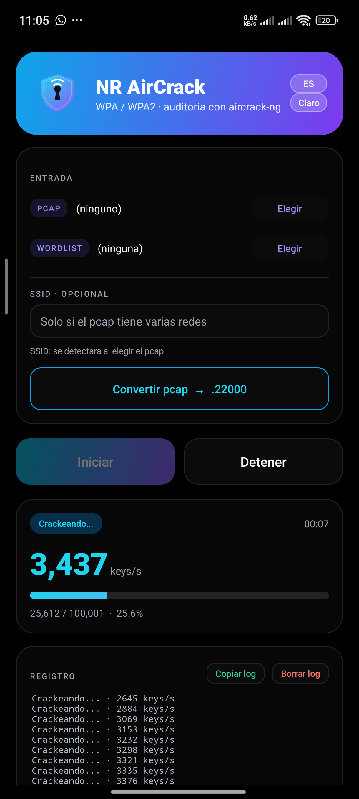
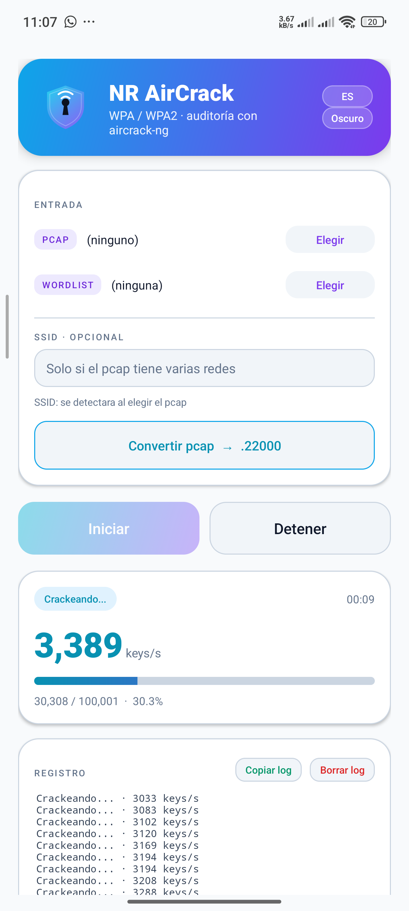
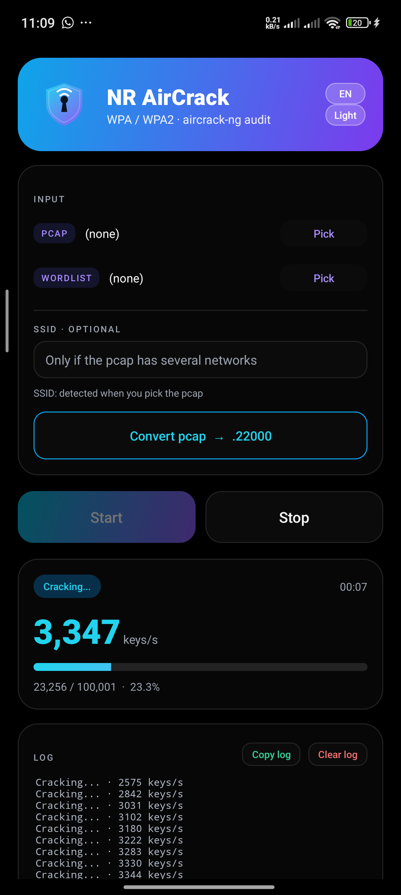
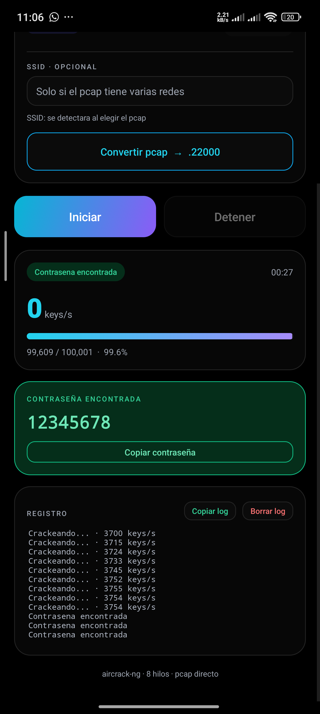

# NR AirCrack

Auditoría de redes **WPA/WPA2 propias** en Android, con el motor real de
`aircrack-ng` incluido. Sin root, sin Termux y sin enviar nada a Internet.

> ⚠️ **Uso legal**: esta app es para auditar redes que sean tuyas o para las
> que tengas permiso escrito. Crackear una red ajena es ilegal en la mayoría
> de países. Los autores no se hacen responsables del mal uso.



## Características

- **Motor aircrack-ng 1.7** compilado para arm64 con NEON, empaquetado dentro
  del APK. No necesita root, Termux ni instalar librerías del sistema.
- **Lee el `.pcap`/`.cap` directamente** (no hace falta convertirlo).
- Detecta automáticamente **SSID y handshake de 4 vías**.
- Usa **todos los núcleos** del teléfono (`-p` = número de núcleos).
- **Servicio en primer plano + wake lock**: sigue crackeando con la pantalla
  apagada.
- **Reanudación automática**: si Android mata el servicio, continúa desde la
  clave exacta que estaba probando (`job.state` + `words_resume`).
- **Registro** con botones *Copiar log* y *Borrar log*.
- **Convertir pcap → .22000** para usar el handshake en hashcat.
- **Español / English** y tema **AMOLED negro puro (`#000000`)** o claro.
- **Sin permiso de INTERNET**: la app no puede subir datos aunque quisiera.
- Paquete independiente `com.nrcracker.air`; convive con otras apps.

## Capturas

| Oscuro AMOLED | Claro |
|---|---|
|  |  |

| English | Resultado |
|---|---|
|  |  |

## Compatibilidad

| Requisito | Valor |
|---|---|
| Android | **8.0 o superior** (minSdk 26; targetSdk 28) |
| Arquitectura | **arm64-v8a** para el motor |
| Root | **No necesario** |
| Permiso de Internet | **No** (la app no lo declara) |

### Dispositivo probado

| Campo | Valor |
|---|---|
| Marca / modelo | POCO / RMX5070 *(según `getprop`)* |
| Android | 15 (API 35) |
| SoC | MediaTek MT6899 (8 núcleos: 2,1 / 3,0 / 3,25 GHz) |
| ABI | arm64-v8a |
| Resultado | Motor, handshake, crackeo, reanudación, temas e idiomas: OK |

### Sobre 32 bits

El APK **se instala** en un teléfono de 32 bits (no lleva carpeta `lib/`),
pero el motor es un ELF **arm64** y no se puede ejecutar en un userspace de
32 bits (`Exec format error`). La interfaz y la conversión a `.22000` sí
funcionan; el crackeo no.

En la práctica, casi todos los teléfonos Android desde 2017 son arm64, y
muchos de 32 bits tienen Android 7 o menos (por debajo del minSdk 26).

## Rendimiento real medido

Medido en el dispositivo de la tabla, con `aircrack-ng 1.7` (`-O2`, NEON) y
la app en primer plano. `-S` de aircrack, 20 s por punto:

| Hilos (`-p`) | keys/s sostenidos |
|---:|---:|
| 1 | 713 |
| 2 | 1.441 |
| 4 | 2.155 |
| 6 | 2.991 |
| 7 | 2.935 |
| **8** | **3.222** (pico 3.247) |
| 9 | 2.868 |
| 10 | 2.978 |
| 12 | 2.990 |
| 8 procesos × 1 hilo | 2.799 |

- **Pico observado**: 5.228 keys/s en ráfaga corta con el teléfono frío.
- **Uso real**: ~2.900–3.700 keys/s según temperatura y carga.
- **8 hilos es el óptimo**; más hilos empeora por contención y calor.
- **`-O3` no aporta nada**: mediana O3/O2 = **0,99** en 8 pares intercalados.
- **Cargando, el power HAL baja el techo** a 2,0 GHz (~1.100–1.500 keys/s).
  Desenchufado y frío vuelve a 2,2 GHz y ráfagas de 2,8–3,25 GHz.
- Comparación: hashcat con PoCL daba ~1.187 H/s por worker y crasheaba con
  `-n 4`; aircrack-ng es más rápido y estable en este hardware.

Más detalle en [`docs/BENCHMARKS.md`](docs/BENCHMARKS.md).

## Instalación

1. Descarga [`apk/NR-AirCrack-v1.5.apk`](apk/NR-AirCrack-v1.5.apk).
2. Permite “Instalar apps desconocidas” para tu gestor de archivos.
3. Abre la app, elige el `.pcap` y la wordlist, y pulsa **Iniciar**.
4. Opcional: pulsa **Evitar cierre en segundo plano** y acepta la exclusión
   de batería (recomendado en HyperOS/MIUI).

No hace falta root. La app pide los archivos con el selector SAF de Android,
así que no necesita permiso de almacenamiento.

## Compilar

Requisitos: JDK, `aapt2`, `d8`, `apksigner`, un `android.jar` (API 34/35) y
Python 3 para insertar el `classes.dex` en el APK.

```sh
cd app
export ANDROID_JAR=/ruta/android.jar
export KEYSTORE=/ruta/release.keystore
export KS_PASS=...
export KEY_ALIAS=...
export KEY_PASS=...
./build.sh
```

El resultado queda en `app/out/app.apk`. El APK publicado está firmado con
una clave de release; **la keystore no se incluye en este repositorio**.

### Motor aircrack-ng

El binario y las librerías están en `app/assets/air/`. Se compilaron desde
`aircrack-ng 1.7` con Clang/NDK, prefijo
`/data/user/0/com.nrcracker.air/files/air` y NEON. El código fuente completo
está en [`third_party/aircrack-ng-1.7.tar.gz`](third_party/aircrack-ng-1.7.tar.gz)
para cumplir con la GPL.

## Privacidad

- La app **no declara `INTERNET`**: no hay telemetría ni subida de datos.
- Todo el procesamiento (pcap, wordlist, handshake) ocurre en el teléfono.
- El handshake de demostración incluido para el autotest es el pcap público
  `wpa2.eapol.cap` de la suite de aircrack-ng (SSID `Harkonen`, clave
  `12345678`). **No contiene capturas de redes reales.**

## Legal

Esta herramienta existe para **auditoría de seguridad y recuperación de la
clave de tu propia red**. No la uses contra redes de terceros. La licencia no
concede ningún derecho sobre redes ajenas.

## Créditos y licencias

- [aircrack-ng](https://www.aircrack-ng.org/) — GPLv2. Motor incluido.
- OpenSSL — Apache License 2.0.
- SQLite — dominio público.
- libc++ — Apache License 2.0 con excepción LLVM.
- zlib — licencia zlib.
- La app (código Java, UI, assets propios) — **GPLv2**.

Ver [`THIRD_PARTY.md`](THIRD_PARTY.md) y [`LICENSE`](LICENSE).
